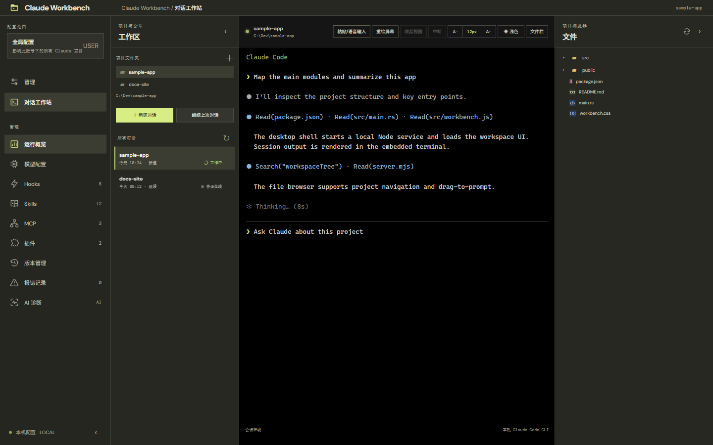

# Claude Workbench

Claude Workbench is a Windows desktop workspace for Claude Code. It puts Claude configuration, projects, terminal sessions, and a project file browser in one window.

> The screenshot uses a fictional project and sample terminal text. It contains no personal project paths or files.



## Install on Windows

1. Install [Node.js](https://nodejs.org/) 20.19+ or 22.12+ and make sure `node.exe` is available on `PATH`.
2. Install Claude Code and make sure `claude` is available on `PATH`.
3. Download and run the [Windows x64 setup](https://github.com/young920/claude-workbench-desktop/releases/latest/download/Claude-Workbench-0.2.31-x64-setup.exe). The MSI installer is also available in the release assets.

The installer is per-user and does not require administrator rights. WebView2 is supplied by Windows on supported Windows 10 and Windows 11 systems. On a system without the runtime, the installer downloads it, so internet access is needed during installation.

Claude Workbench starts a local Node.js service when it opens. Node.js and Claude Code must remain installed for the desktop app to create or resume sessions.

## Features

- Manage Claude Code models, hooks, skills, MCP servers, plugins, and diagnostics.
- Keep multiple projects and Claude Code sessions in one workspace.
- Browse project files, expand folders, refresh the tree, and drag or copy paths into a conversation.
- Open files in their default app, reveal and select files in Explorer, or move files to the Windows Recycle Bin.
- See when a running session is working or waiting for input.

Project files and terminal sessions run through a local service bound to `127.0.0.1`. Prompts sent to Claude Code use the provider configured in your Claude Code environment.

## Build from source

### Requirements

- Windows 10 or Windows 11, x64
- Node.js 20.19+ or 22.12+
- Rust stable with the `x86_64-pc-windows-msvc` target
- Microsoft C++ Build Tools with **Desktop development with C++**
- WebView2 Runtime

Install the Rust target if it is not already present:

```powershell
rustup target add x86_64-pc-windows-msvc
```

### Commands

```powershell
npm ci
npm run desktop:dev
```

Build the Windows installers:

```powershell
npm run desktop:build
```

The NSIS and MSI installers are written to `src-tauri/target/release/bundle/`.

## Download the installer

- [Windows x64 setup (.exe)](release/Claude-Workbench-0.2.31-x64-setup.exe)
- [Windows x64 MSI](release/Claude-Workbench-0.2.31-x64.msi)
- [SHA-256 checksums](release/SHA256SUMS.txt)

Version: `0.2.31`
